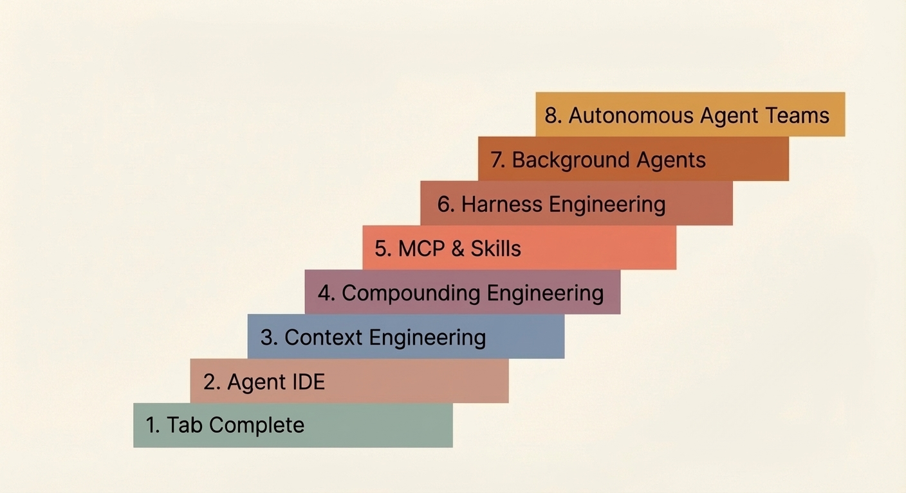

This year the move toward hands-off AI native development has accelerated dramatically. AI-assisted coding was quite commonplace throughout 2025 but this year, full automation has become commonplace. I really like this article about how the journey might look from simple tab-completion all the way to AI native building.<!--more--> From [Bassim Eledath's blog](https://www.bassimeledath.com/blog/levels-of-agentic-engineering): 

The whole article is worth reading.